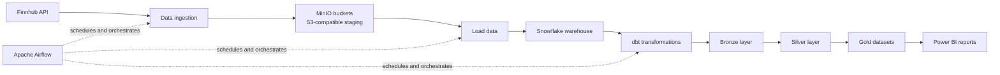

# Stock Market Data Streaming

An end-to-end data engineering project that streams stock market data from the Finnhub API, stages it in MinIO, loads it into Snowflake, transforms it with dbt, and visualizes curated datasets in Power BI. Apache Airflow orchestrates the pipeline.

## Project overview

This project demonstrates a complete path from source data to analytics. Raw market data is collected from Finnhub and stored in MinIO, an S3-compatible object store. The data is then loaded into Snowflake and transformed into bronze, silver, and gold layers using a medallion architecture. Power BI connects to the gold datasets for reporting and visualization.

## Background

Stock market data can be valuable for analysis when it is collected reliably, retained in a staging layer, and organized into datasets that are ready for reporting. This project brings together API ingestion, object storage, a cloud data warehouse, transformation tooling, orchestration, and business intelligence in one workflow.

## Objectives

- Retrieve stock market data from the Finnhub API.
- Store raw ingested data in MinIO buckets.
- Load staged data into Snowflake.
- Apply medallion-style transformations with dbt.
- Publish gold-layer datasets for Power BI.
- Schedule and coordinate pipeline tasks with Apache Airflow.

## Architecture and data flow

1. Airflow schedules the ingestion workflow.
2. The pipeline retrieves data from Finnhub and stages it in MinIO.
3. Staged data is loaded into Snowflake.
4. dbt models transform warehouse data through bronze, silver, and gold layers.
5. Power BI uses the gold datasets for visualization and reporting.

## Project dependencies

| Dependency | Purpose | Configuration needed |
| --- | --- | --- |
| Finnhub API | Stock market data source | API key and endpoint settings |
| MinIO | S3-compatible data staging | Endpoint, bucket, and access credentials |
| Snowflake | Data warehouse | Account, warehouse, database, schema, and credentials |
| dbt | Warehouse transformations | Project configuration and Snowflake connection |
| Apache Airflow | Scheduling and orchestration | Airflow environment and connections/secrets |
| Power BI | Reporting and visualization | Access to the Snowflake gold datasets |

## Technologies

- **Finnhub API** — market data source
- **MinIO** — S3-compatible object storage
- **Snowflake** — cloud data warehouse
- **dbt** — data modeling and medallion transformations
- **Apache Airflow** — workflow orchestration
- **Power BI** — dashboards and visualizations
